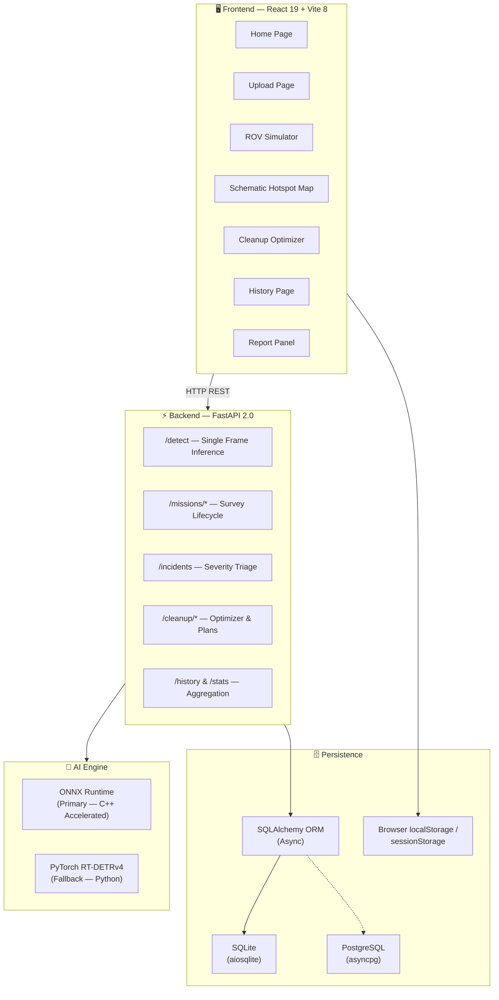
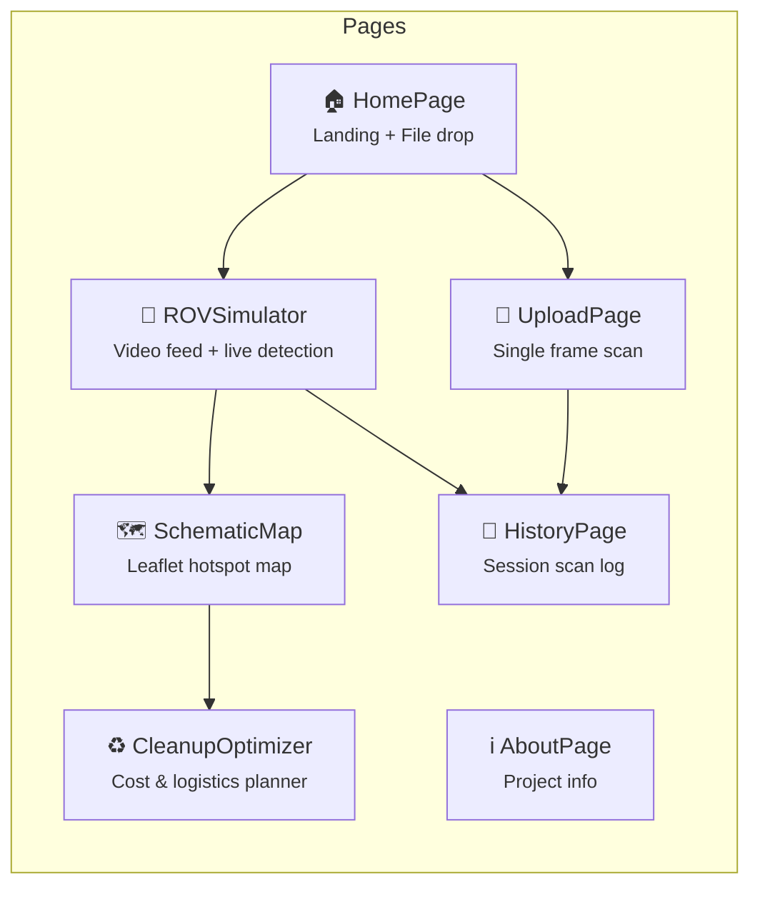
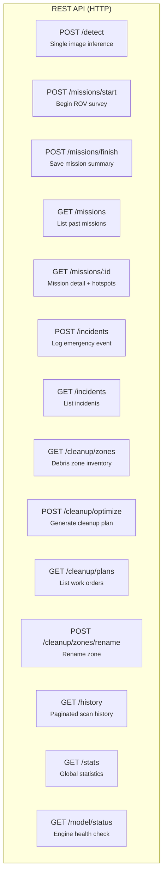
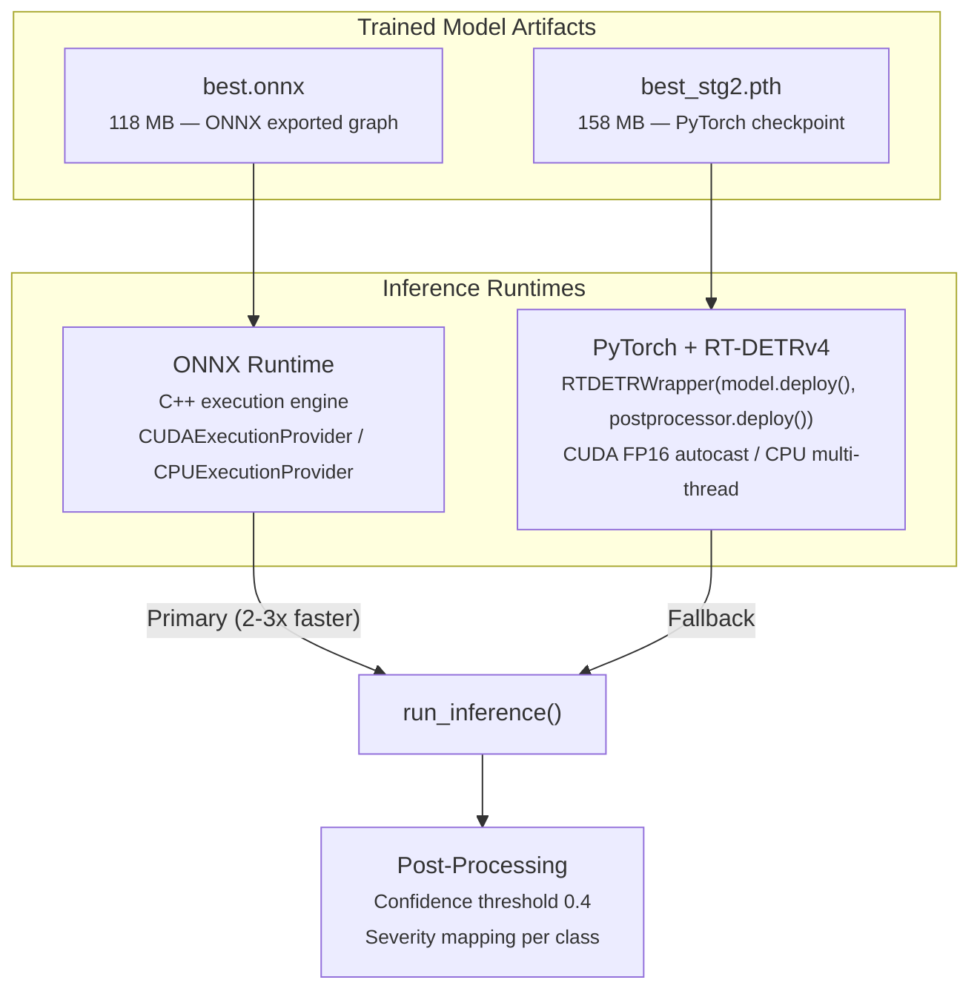
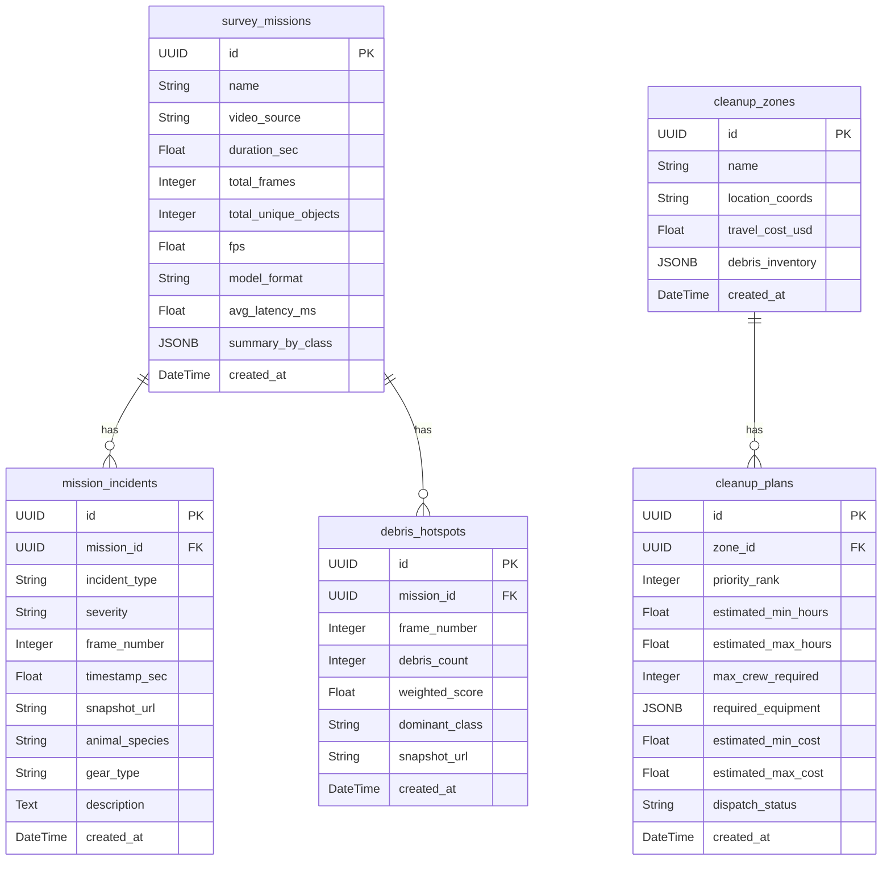
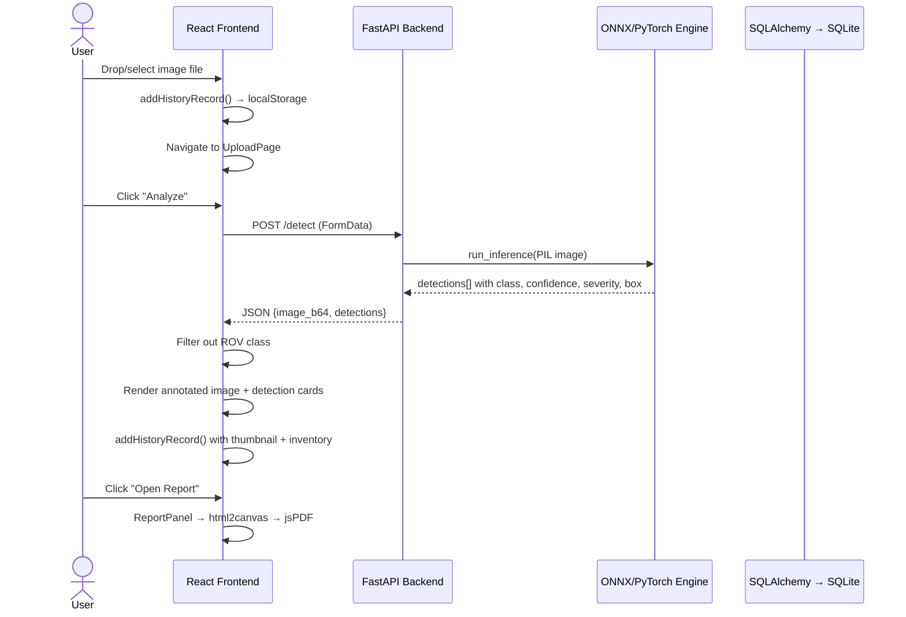
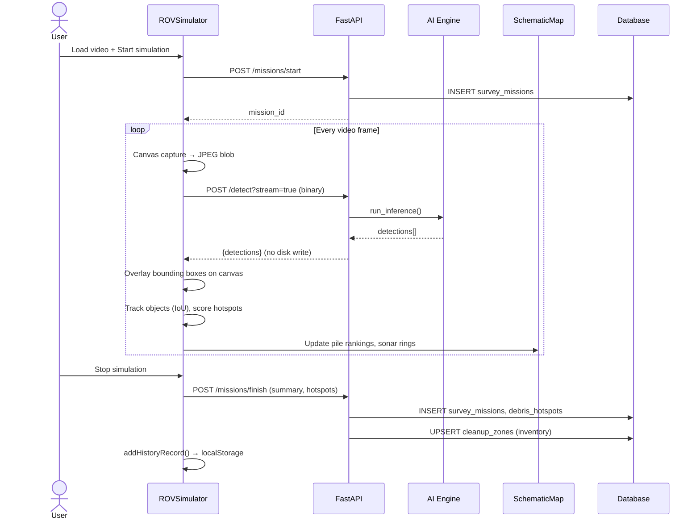
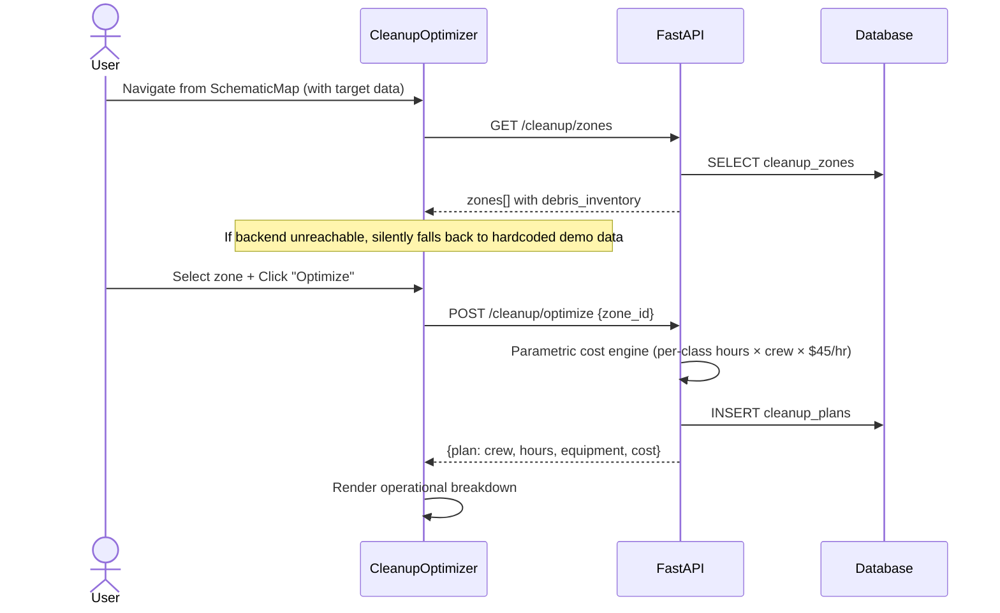

# BlueSentinel — System Architecture & Workflow

> ⚠️ **Updated October 2026** — reflects the current codebase. `BatchStreamPage` and `useBatchStream` have been removed. `HistoryPage`, `NavBar`, `ErrorBoundary`, `utils/drawing.js`, and `utils/alerts.js` have been added.

> Real-time marine debris detection, ecological severity triage, and autonomous cleanup logistics platform.

---

## High-Level Architecture



---

## 1. Frontend Layer

| Component | File | Technology | Purpose |
|-----------|------|-----------|---------|
| **Build System** | `vite.config.js` | **Vite 8.3** | Ultra-fast HMR dev server, ESBuild bundling, production Rollup build |
| **UI Framework** | `main.jsx`, `App.jsx` | **React 19.3** | SPA with session-persistent page rendering (`display: none/block` pattern — no unmounting) |
| **Styling** | `index.css` | **Vanilla CSS** (25 KB design system) + **Tailwind CSS 4.3** (utility layer) | Glassmorphism dark theme, gradients, animations, responsive grid |
| **Animation** | Components | **Framer Motion 13.4** | Page transitions, card hover effects, micro-animations |
| **Icons** | Components | **Lucide React 1.47** | SVG icon library (200+ marine/UI icons) |
| **Mapping** | `SchematicMap.jsx` | **Leaflet 1.9** | Interactive debris hotspot mapping with sonar rings, ROV dive markers, heatmap overlays |
| **PDF Export** | `ReportPanel.jsx` | **jsPDF 4.2** + **html2canvas 1.4** | Client-side PDF generation for assessment reports |
| **State Persistence** | `useHistory.js` | **sessionStorage** + **localStorage** | Session-scoped page navigation; localStorage for scan history with quota-safe thumbnail stripping |
| **Error Handling** | `ErrorBoundary.jsx` | **React class component** | Catches runtime errors app-wide; renders themed fallback UI with Reload / Home actions |
| **Shared Drawing** | `utils/drawing.js` | **HTML5 Canvas API** | `drawBoxes()`, `CLASS_COLORS`, `SEVERITY_COLOR`, `getColor()`, `boxIoU()` — shared across all components |
| **Alert Logic** | `utils/alerts.js` | **Pure JS** | `evaluateAlerts()`, `weightedScore()` — shared across ROV Simulator and other pages |

### Page Components



### Key Custom Hooks

| Hook | File | Role |
|------|------|------|
| `useHistory` | [useHistory.js](file:///c:/Users/user/Desktop/blueSent-FE/frontend/src/hooks/useHistory.js) | Manages scan history records in `localStorage` with thumbnail quota protection. Exports `addHistoryRecord()` for any page to persist scan results. |

> **Removed:** `useBatchStream.js` — deleted along with `BatchStreamPage.jsx`. The WebSocket batch stream workflow has been removed from the current version.

---

## 2. Backend Layer

| Component | File | Technology | Purpose |
|-----------|------|-----------|---------|
| **Web Framework** | [main.py](file:///c:/Users/user/Desktop/blueSent-FE/backend/main.py) | **FastAPI 2.0** + **Uvicorn** (ASGI) | Async HTTP/WebSocket server with CORS, static file serving |
| **Batch Processor** | [batch_processor.py](file:///c:/Users/user/Desktop/blueSent-FE/backend/batch_processor.py) | **Python** (pure algorithmic) | Multi-object IoU tracking, zone isolation, hotspot aggregation, alert evaluation |
| **Database ORM** | [models.py](file:///c:/Users/user/Desktop/blueSent-FE/backend/models.py) | **SQLAlchemy** (async mode) | Portable UUID/JSONB type decorators, 5 ORM models |
| **Database Engine** | [database.py](file:///c:/Users/user/Desktop/blueSent-FE/backend/database.py) | **aiosqlite** (default) / **asyncpg** (PostgreSQL) | Auto-detection of PostgreSQL via TCP probe; seamless SQLite fallback |
| **Static Files** | `/uploads/` | **FastAPI StaticFiles** | Serves annotated images, incident snapshots |

### API Endpoints



> **Removed:** `WS /ws/batch` — the WebSocket batch stream endpoint is no longer used by the frontend.

---

## 3. AI Inference Engine



### Model Details

| Property | Value |
|----------|-------|
| **Architecture** | RT-DETRv4 / D-FINE (HGNetv2-L backbone) |
| **Training Data** | TrashCan 1.0 (underwater debris dataset) |
| **Input Resolution** | 640 × 640 px |
| **Confidence Threshold** | 0.40 |
| **Classes (22)** | `rov`, `plant`, `animal_fish`, `animal_starfish`, `animal_shells`, `animal_crab`, `animal_eel`, `animal_etc`, `trash_clothing`, `trash_pipe`, `trash_bottle`, `trash_bag`, `trash_snack_wrapper`, `trash_can`, `trash_cup`, `trash_container`, `trash_unknown_instance`, `trash_branch`, `trash_wreckage`, `trash_tarp`, `trash_rope`, `trash_net` |
| **Weights Source** | HuggingFace: `coding-droid-123/trashcan-dfine` |
| **ONNX Format** | Opset 16, dynamic axes for batch inference |

### Severity Classification

| Tier | Classes | Ecological Risk |
|------|---------|-----------------|
| 🔴 **Critical** | `trash_net`, `trash_rope`, `trash_tarp` | Ghost gear — active marine entanglement |
| 🟠 **High** | `trash_bottle`, `trash_bag`, `trash_container`, `trash_snack_wrapper`, `trash_cup`, `trash_pipe`, `trash_wreckage` | Non-biodegradable plastics, chemical leaching |
| 🟡 **Medium** | `trash_can`, `trash_clothing`, `trash_unknown_instance` | Metals, fabrics, general artificial debris |
| 🟢 **Low** | `trash_branch`, `rov`, `plant`, `animal_*` | Natural materials, organisms, equipment |

---

## 4. Batch Processing Pipeline

| Component | Class / Function | Technology | Purpose |
|-----------|-----------------|-----------|---------|
| **Filename Parser** | `parse_filename_zone_and_frame()` | Regex (`(vid_\d+)_(\d+)`) | Extracts zone ID and frame number from image filenames |
| **Zone Tracker** | `ZoneTracker` | IoU-based multi-object tracker | Per-zone isolated tracking with gap-triggered resets (`gap_threshold = 10 frames`) |
| **Alert Evaluator** | `AlertEvaluator` | Rule engine | Generates `ENTANGLEMENT`, `GHOST_GEAR`, `LARGE_PILE` alerts based on co-occurrence of animals + trash |
| **Hotspot Aggregator** | `HotspotAggregator` | Sliding window (N=30 frames) | Deduplicates tracks across frames, scores debris clusters by weighted density |

### Hazard Weight Scores

| Class | Weight | Rationale |
|-------|--------|-----------|
| `trash_net`, `trash_rope` | 3.0 | Highest entanglement risk |
| `trash_tarp` | 2.5 | Large-area smothering |
| `trash_pipe`, `trash_wreckage` | 2.0 | Structural hazard |
| `trash_bag` | 1.5 | Ingestion risk |
| `trash_bottle`, `trash_cup`, `trash_clothing` | 1.0 | Standard debris |
| `trash_branch`, `trash_snack_wrapper` | 0.8 | Minor |

---

## 5. Database Layer



### Portable Type System

| Custom Type | PostgreSQL | SQLite | Implementation |
|-------------|-----------|--------|----------------|
| `UUID` | `pg.UUID(as_uuid=True)` | `CHAR(36)` | `TypeDecorator` with bidirectional `uuid.UUID` coercion |
| `JSONB` | `pg.JSONB()` | `TEXT` (JSON serialized) | `TypeDecorator` with `json.dumps/loads` for SQLite |

### Database Selection Logic

```
Startup → TCP probe localhost:5432
  ├─ ✅ PostgreSQL reachable → asyncpg driver
  └─ ❌ Unreachable → SQLite fallback (bluesentinel.db)
```

---

## 6. End-to-End Workflow

### Workflow A: Single Image Scan



### Workflow B: ROV Video Simulation



> **Removed:** Workflow C (Batch Image Stream) — `BatchStreamPage.jsx` and `useBatchStream.js` have been deleted. The WebSocket `/ws/batch` endpoint exists in the backend but is no longer connected to any frontend page.

### Workflow C: Cleanup Optimization



---

## 7. Technology Summary

### Backend Stack

| Layer | Technology | Version | Role |
|-------|-----------|---------|------|
| **Runtime** | Python | 3.10+ | Core language |
| **Web Framework** | FastAPI | 2.0 | Async HTTP/WS endpoints |
| **ASGI Server** | Uvicorn | Latest | Production-grade ASGI server |
| **AI Primary** | ONNX Runtime | Latest | C++ accelerated inference (CUDA/CPU) |
| **AI Fallback** | PyTorch + Torchvision | Latest | Python model execution |
| **Model Hub** | HuggingFace Hub | Latest | Weight auto-download |
| **ORM** | SQLAlchemy | 2.0 (async) | Database abstraction |
| **DB Driver (default)** | aiosqlite | Latest | Async SQLite |
| **DB Driver (prod)** | asyncpg | Latest | Async PostgreSQL |
| **Image Processing** | Pillow + NumPy | Latest | Image decode, resize, annotate |
| **WebSocket** | websockets | Latest | Real-time binary frame streaming |

### Frontend Stack

| Layer | Technology | Version | Role |
|-------|-----------|---------|------|
| **Build** | Vite | 8.3 | ESBuild dev server + Rollup production |
| **UI** | React | 19.3 | Component-based SPA |
| **Styling** | Vanilla CSS + Tailwind CSS | 4.3 | Design system + utility classes |
| **Animation** | Framer Motion | 13.4 | Declarative micro-animations |
| **Icons** | Lucide React | 1.47 | SVG icon library |
| **Maps** | Leaflet | 1.9 | Interactive geospatial hotspot visualization |
| **PDF** | jsPDF + html2canvas | 4.2 / 1.4 | Client-side report generation |
| **State** | React Hooks + Storage API | Native | sessionStorage (nav) + localStorage (history) |

### Infrastructure

| Component | Technology | Purpose |
|-----------|-----------|---------|
| **Containerization** | Docker Compose | Optional PostgreSQL + backend orchestration |
| **Model Weights** | HuggingFace `coding-droid-123/trashcan-dfine` | Auto-downloaded on first start |
| **File Storage** | Local filesystem (`/uploads/`) | Annotated images, incident snapshots |
| **CORS** | FastAPI middleware | `allow_origins=["*"]` for dev |

---

## 8. Directory Structure

```
blueSent-FE/
├── backend/
│   ├── main.py                    # FastAPI app (1,126 lines) — all endpoints
│   ├── models.py                  # SQLAlchemy ORM (5 tables)
│   ├── database.py                # Async engine + PG/SQLite auto-select
│   ├── batch_processor.py         # ZoneTracker, AlertEvaluator, HotspotAggregator
│   ├── requirements.txt           # Python dependencies
│   ├── bluesentinel.db            # SQLite database (auto-created)
│   ├── weights/
│   │   ├── best.onnx              # ONNX model (118 MB)
│   │   └── best_stg2.pth          # PyTorch checkpoint (158 MB)
│   ├── uploads/
│   │   └── incidents/             # Saved incident snapshots
│   ├── RT-DETRv4/                 # Model architecture source (PyTorch fallback)
│   ├── init_db.py                 # Database initialization script
│   ├── convert_pth_to_onnx.py     # Model conversion utility
│   └── start.bat                  # Windows startup script
│
├── frontend/
│   ├── package.json               # React 19 + Vite 8
│   ├── src/
│   │   ├── main.jsx               # React DOM entry — wraps <App> in <ErrorBoundary>
│   │   ├── App.jsx                # Root SPA router (session-persistent pages)
│   │   ├── config.js              # API_BASE_URL + WS_BASE_URL (env-var aware)
│   │   ├── index.css              # 25 KB design system
│   │   ├── components/
│   │   │   ├── NavBar.jsx         # ✅ Shared navigation bar (all pages)
│   │   │   ├── ErrorBoundary.jsx  # ✅ App-wide crash recovery UI
│   │   │   ├── HomePage.jsx       # Landing page + file drop zone
│   │   │   ├── UploadPage.jsx     # Single image scan dashboard
│   │   │   ├── ROVSimulator.jsx   # Video feed with live detection overlay
│   │   │   ├── SchematicMap.jsx   # Leaflet hotspot map + pile rankings
│   │   │   ├── CleanupOptimizer.jsx# Cleanup cost & logistics planner
│   │   │   ├── HistoryPage.jsx    # ✅ Scan session history browser
│   │   │   ├── ReportPanel.jsx    # PDF report generator
│   │   │   ├── AboutPage.jsx      # Project information
│   │   │   ├── ImageUploader.jsx  # Drag-and-drop image input
│   │   │   └── LoadingOverlay.jsx # Loading spinner overlay
│   │   │   # ❌ Removed: BatchStreamPage.jsx, DetectionPanel.jsx, AuthModal.jsx
│   │   ├── hooks/
│   │   │   └── useHistory.js      # ✅ localStorage scan history (read + write)
│   │   │   # ❌ Removed: useBatchStream.js
│   │   └── utils/
│   │       ├── drawing.js         # ✅ drawBoxes(), CLASS_COLORS, SEVERITY_COLOR, boxIoU()
│   │       └── alerts.js          # ✅ evaluateAlerts(), weightedScore()
│   └── dist/                      # Production build output
│
└── docs/                          # Documentation
```
